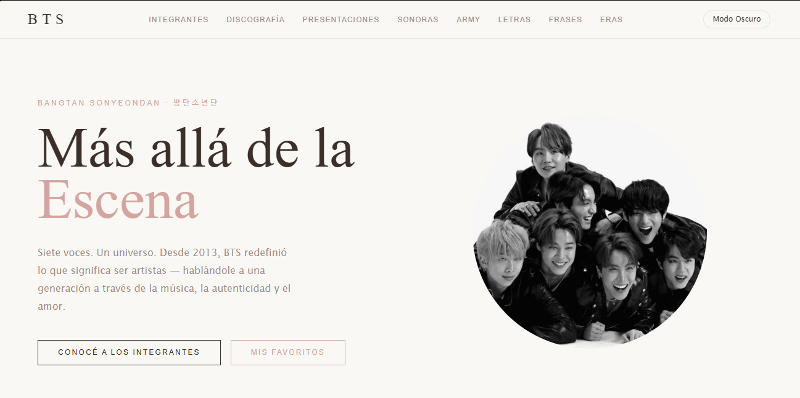
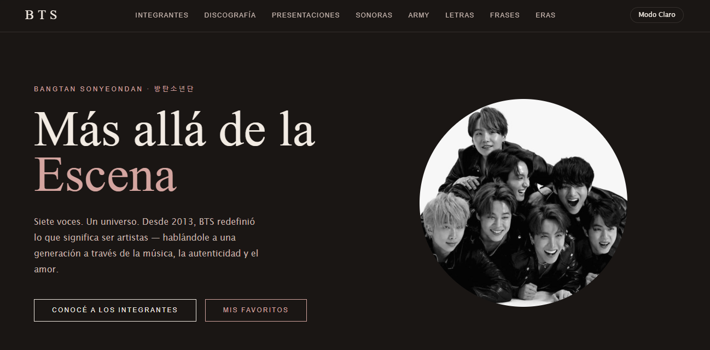

# Borahae — BTS Interactive Archive

> Archivo editorial e interactivo dedicado a la música y el universo de **BTS (Bangtan Sonyeondan)**.

**[Ver Demo en Vivo](https://tu-link-de-deploy.vercel.app)** 

---

## Vista Previa

| Modo Claro | Modo Oscuro & Mis Favoritos |
| :---: | :---: |
|  |  |

---

## Características Principales

- **Perfiles de Integrantes:** Fichas detalladas con biografía, datos técnicos y modales interactivos.
- **Discografía Completa (Grupal y Solista):** Exploración por álbumes con historia del lanzamiento, metadatos, listado de canciones y enlaces directos a Spotify.
- **Presentaciones:** Compilación de las mejores presentaciones en premios o shows que ha tenido BTS a lo largo de su trayectoria como grupo, se puede ver directamente desde la pagina cada presentacion.
- **Experiencia Sonora:** Diferentes esperiencias sonoras de todo lo que representa bts.
- **Fandom ARMY:** Explicacion interactiva de que es y lo que representa army junto a todo lo que han logrado como fandom.
- **Letras que dejan huella:** Tarjetas visuales con frases icónicas y vista previa modal.
- **Frases que nos marcaron:** Conjunto de tarjetas donde se ve las diferentes frases que dijieron cada miembro de BTS, ideal para subirle el animo a cualquiera que pase por esta pagina.
- **Línea de Tiempo por Eras:** Recorrido cronológico desde el debut hasta *Arirang*, con galerías de fotos y discos asociados.
- **Sección "Mis Favoritos" unificada:** Sistema de likes (`♥`) en toda la aplicación sincronizado en tiempo real mediante `localStorage` y eventos personalizados (`favoritesUpdated`).
- **Modo Claro / Oscuro:** Sistema de temas dinámico basado en CSS Custom Properties (`--cream`, `--deep`, `--accent`).
- **Diseño Responsivo:** Maquetado fluido adaptable a escritorio, tablet y móvil mediante CSS Grid, Flexbox y Media Queries.

---

## Tecnologías Utilizadas

- **React:** Arquitectura basada en componentes funcionales y hooks (`useState`, `useEffect`).
- **CSS3:** Variables CSS para tematización, animaciones *scroll reveal* con `IntersectionObserver` y diseño responsivo sin dependencias externas.
- **Web Storage API (`localStorage`):** Persistencia local de favoritos y preferencias de tema del usuario.
- **Vite:** Entorno de desarrollo rápido y empaquetado optimizado.

---

## Autora
Desarrollado por **Nerina Luciana Bonnin**

> GitHub: https://github.com/NerinaBonnin
> Linkedin: https://www.linkedin.com/in/nerina-bonnin-ba8879252/

